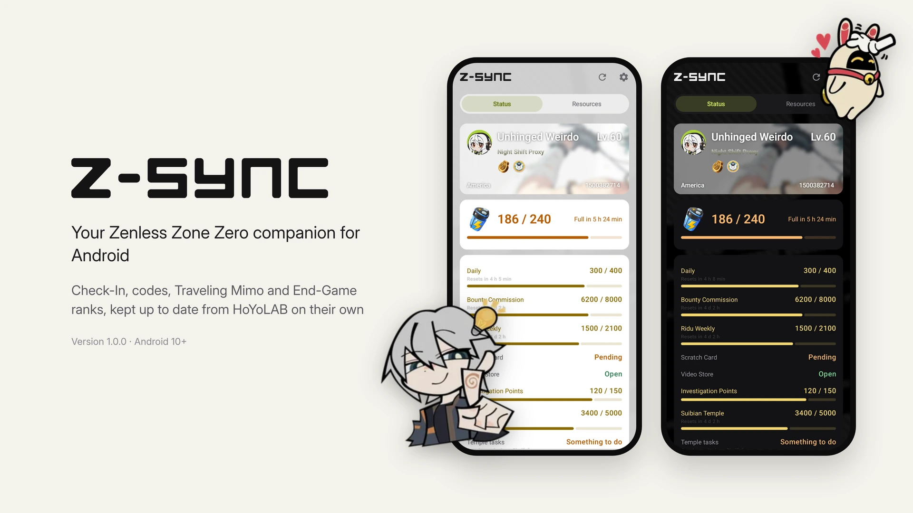
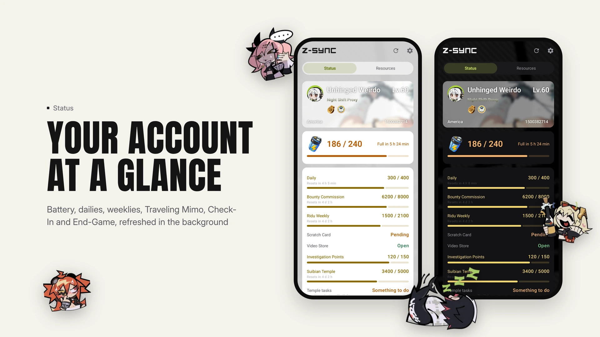
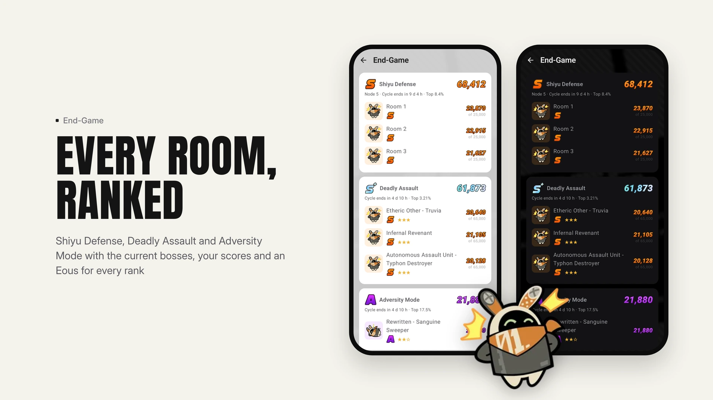
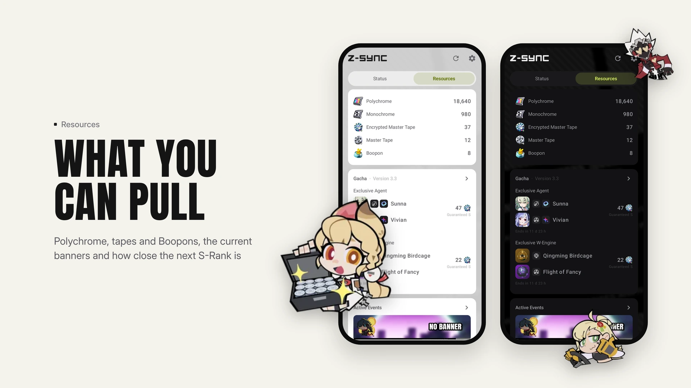
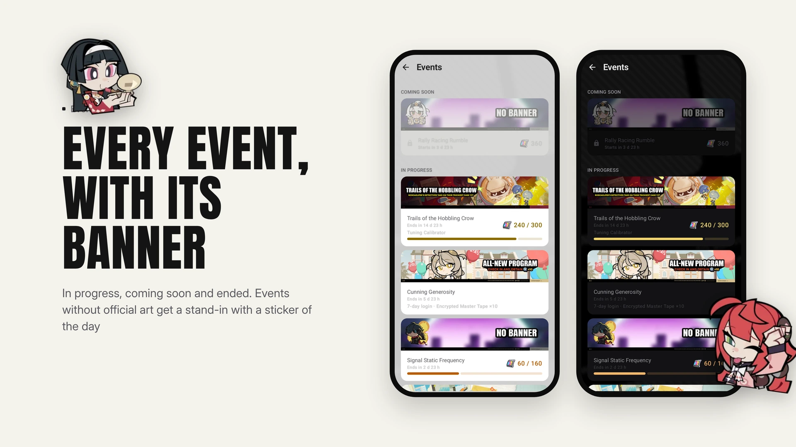
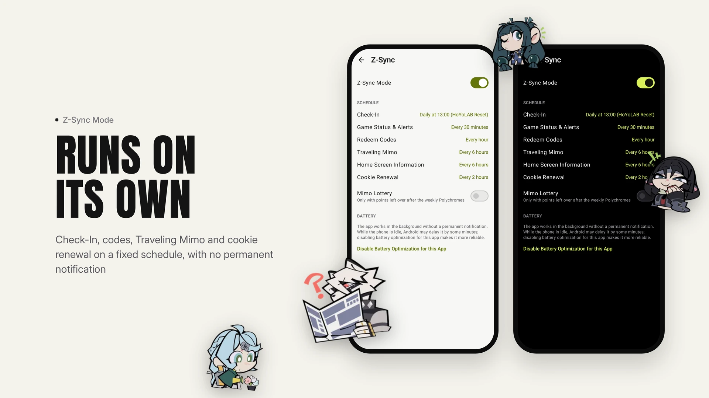
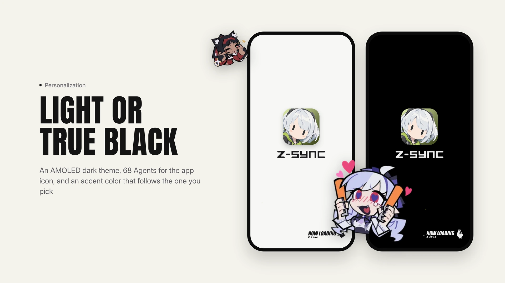

<h1 align="center">Z-Sync</h1>

A Zenless Zone Zero companion for Android that keeps your HoYoLAB account up to date on its own: Check-In, codes, Traveling Mimo, End-Game ranks and the banners to come.

  
  
  
  

## Download

Get the APK from the [latest release](../../releases/latest). Android 10 or newer. The app checks this repository for new versions and can update itself from Settings.

## Build

Requires JDK 17+ and the Android SDK (platform 35). Create `local.properties` with `sdk.dir=<path to SDK>`, then:

    ./gradlew :app:assembleDebug

API smoke tests (no account needed): `LIVE=1 ./gradlew :core:test`

## Structure

- `core/` – plain Kotlin, no Android: HoYoLAB API, login, scheduling engine, Mimo, update checks, and readers for the official update notices, Game8 and the Fandom wiki.
- `app/` – Android: storage, notifications, background work, widget, Jetpack Compose UI.

## Credits and disclaimer

Z-Sync is a free fan project, distributed only through this GitHub repository. It is not on Google Play or
any other store.

**None of the images, icons, stickers, sounds, names or other game content used in Z-Sync belong to me.**
All credit goes to their respective authors:

- **HoYoVerse** – Zenless Zone Zero, HoYoLAB and every character, icon, artwork, sound and name from the game.
- **[torikushiii](https://github.com/torikushiii)** – creator of [hoyolab-auto](https://github.com/torikushiii/hoyolab-auto), the project that inspired Z-Sync.
- **[zzze.ro](https://zzze.ro/stickers)** – collected the stickers used in the app and in the promo images.
- **[Game8](https://game8.co)** and the **[Zenless Zone Zero Fandom wiki](https://zenless-zone-zero.fandom.com)** – upcoming banners and fallback boss information. Current bosses come from the official HoYoVerse update notices.
- **[genshin.py](https://github.com/thesadru/genshin.py)** – API details were cross-checked against it.

Z-Sync is not affiliated with, endorsed by or connected to HoYoVerse in any way. If you own any of this content
and want it removed, open an issue and it will be taken down.

## License

Code under the [MIT License](LICENSE). Game names, images and other assets belong to their respective owners.
